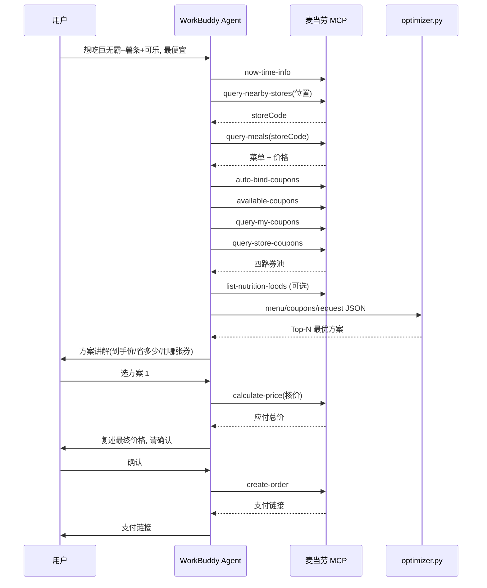

# MCP 集成说明 · MCP_INTEGRATION

本文档说明「麦门省钱精算师」**实际使用**的麦当劳 MCP 能力、调用流程与业务价值。

## 一、使用的 MCP Server

| 项目 | 值 |
|---|---|
| Server 名称 | `mcd-mcp` |
| 接入地址 | `https://mcp.mcd.cn` |
| 传输协议 | Streamable HTTP |
| 鉴权方式 | 请求头 `Authorization: Bearer <MCD_MCP_TOKEN>` |
| 限流 | 每 Token 600 次/分钟，超限返回 429 |
| 配置示例 | [`mcp-config.example.json`](mcp-config.example.json)（仅含环境变量占位符，无真实凭证） |

## 二、使用的 Tool 清单

本项目实际调用以下 16 个麦当劳 MCP Tool，覆盖「定位 → 取菜单 → 领券 → 算价 → 下单」全链路：

| # | Tool | 用途 | 调用时机 |
|---|---|---|---|
| 1 | `now-time-info` | 获取当前时间，判断早餐/正餐时段 | 每次开场 |
| 2 | `query-nearby-stores` | 定位附近门店（到店场景） | 确定门店时 |
| 3 | `delivery-query-addresses` | 查询配送地址（外送场景） | 外送定位时 |
| 4 | `delivery-create-address` | 新增配送地址 | 用户无地址时 |
| 5 | `delivery-query-stores` | 查询可配送门店 | 外送定位时 |
| 6 | `query-meal-assistance` | 团餐助餐服务查询 | 企业团餐场景 |
| 7 | `query-meals` | **查询可售餐品列表**（菜单/价格主数据源） | 取数核心 |
| 8 | `query-meal-detail` | 查询餐品/套餐详情与可选替换项 | 细化候选时 |
| 9 | `list-nutrition-foods` | **餐品营养信息**（能量/蛋白/脂肪/钠…） | 有热量约束时 |
| 10 | `available-coupons` | 麦麦省可领券列表 | 建券池 |
| 11 | `auto-bind-coupons` | **一键领取麦麦省全部可用券** | 建池前必调 |
| 12 | `query-my-coupons` | 我的优惠券 | 建券池 |
| 13 | `query-store-coupons` | 当前门店可用券 | 建券池 |
| 14 | `calculate-price` | **商品价格计算**（可含券，返回应付总价） | 下单前核价 |
| 15 | `create-order` | 创建订单并返回支付链接 | 用户确认后 |
| 16 | `cancel-order` | 取消订单 | 用户要求时 |

> 其中 `query-meals`、`list-nutrition-foods`、`auto-bind-coupons`、
> `calculate-price`、`create-order` 是构成核心价值的五个关键 Tool。

## 三、调用流程



## 四、数据流：从 MCP 返回到优化器输入

MCP 返回的是业务原始结构，需归一化为 `optimizer.py` 的输入契约：

```
MCP 返回                              optimizer 输入
─────────────                         ────────────────
query-meals.items[]        ──────►    menu.json .items[]
  .code / .name / .price                  .code/.name/.category/.price/.tags

list-nutrition-foods[]     ──────►    menu.json .items[].calories

auto-bind + available-      ──────►   coupons.json .coupons[]
  coupons + my + store       (按 5 类券建模:
                              item_price/percent/threshold/
                              bundle_price/free_gift)

用户自然语言                ──────►   request.json
                                       .wants/.budget/.max_calories/...
```

详细的字段映射表见 [`skills/mcd-saver-strategist/references/mcp-tools.md`](skills/mcd-saver-strategist/references/mcp-tools.md)。

## 五、业务价值

1. **把优惠算到极致**：四路券池合并 + 自动领券 + 组合优化，让用户手里的每张券都参与最优解。
   样例中一顿饭从 ¥47 降到 ¥21.9，省钱 53%。
2. **杜绝"假便宜"**：所有价格来自 MCP，下单前用 `calculate-price` 复核，方案价 = 实付价。
3. **真实闭环**：从"想吃"到"下单支付"全在对话内完成，无需用户自己比价、凑单、找券。
4. **实时准确**：菜单、价格、券均来自 MCP 实时接口，不是硬编码快照，避免"数据过期"。
5. **可扩展**：5 类券的抽象可覆盖麦当劳后续新增的各类优惠活动，新增券型只需扩展 `optimizer.py` 的建模分支。

## 六、核验说明（供评审参考）

- 本仓库源码中的示例数据（`scripts/sample_data/`）为**脱敏演示数据**，字段结构对齐 MCP 返回的归一化结果；
- 真实运行时，数据来自麦当劳 MCP 实时返回，代码中不含任何真实 Token / 密钥 / 账号凭证；
- 复现步骤：配置好 MCP Token → 安装 Skill → 对话「我想吃巨无霸套餐，怎么点最便宜」→
  观察 Agent 调用上述 Tool 并输出优化方案。
